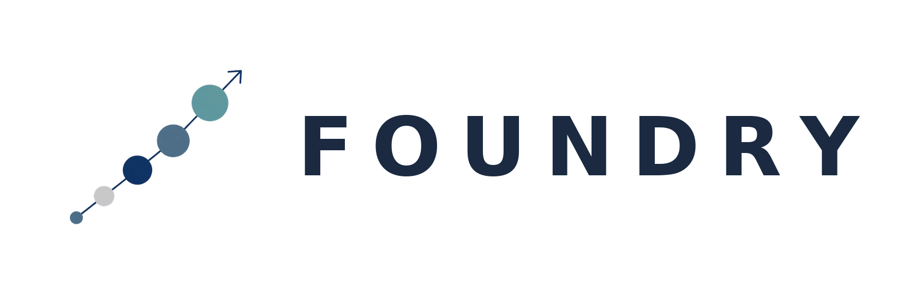

# Foundry — a creator plugin for Hermes Agent

Five creator bots sharing **one structured memory ledger**: research,
draft, score, and price your work — and remember what worked. Built
for the **Hermes Agent Plugin Hackathon** (Nov 2026).

**Start here: say "foundry start" in chat.** A short interview sets
up your brand (only the first question is required). Your brand lives
in the **Brand** tab on the dashboard, where you can view and edit it
any time. Drafting refuses the seeded demo brand until you have your
own.

## The crew

- **Cartographer** — interviews you, owns the brand.
- **Lookout** — sourced research (agent-supplied; no live web-search
  surface exists in Hermes v0.23.0).
- **Scribe** — drafts from cited Evidence Cards only. A claim with no
  source is cut. Live revisions use the host model via `ctx.llm`.
- **Scorekeeper** — performance: what to repeat, what to drop.
- **Bursar** — costs, revenue, profit, brand partnerships, tax
  tracking (tracking only — no advice, no filing).

Every bot reads and writes the same versioned ledger cards. Feedback
becomes a Revision Card. Performance and money write back, so the
next cycle is smarter.

## The board

Four tabs, on the web dashboard and in the Desktop app (opt-in):
**Proofing Table** (all drafts, newest first — Tweak / Reject feed
back to Scribe), **Brand**, **Scorekeeper**, **Bursar**.

**Approval is disabled, not implemented.** There is no trusted human
review channel yet, so the Approve buttons are disabled and the
approve routes fail closed. Nothing auto-posts, auto-sends, or
auto-buys. Ever.

## Tools (8)

`foundry_start`, `foundry_ledger_list`, `foundry_ledger_get`,
`foundry_draft_create`, `foundry_draft_feedback`,
`foundry_draft_approve`, `foundry_scorecard`, `foundry_money_summary`.

## Install

```bash
cp -r foundry ~/.hermes/plugins/foundry
hermes plugins validate ~/.hermes/plugins/foundry --install-deps
hermes plugins doctor foundry --ci
hermes plugins enable foundry
```

Copy the inner `foundry` folder, not the whole project, or validation
fails with "no plugin.yaml". Validated against Hermes v0.23.0:
validate 16/16, doctor 8 tools, smoke test 34/34. Full record in
`docs/VALIDATION.md`.

## Disclosures

- **Network calls:** none. The plugin makes no calls to third-party
  services. Scribe's live revision path uses the host model's
  `ctx.llm` (no external API key held by the plugin).
  Scorekeeper/Bursar numbers in the seeded demo are illustrative
  example data, labelled `estimated` on the dashboard.
- **Reads outside its own data:** none. The plugin reads only its own
  ledger, stored at `plugin_db("foundry")`.
- **Shell commands / background processes:** none.
- **Stored credentials:** none. No API keys, no `.env`, no OAuth.
- **Telemetry / usage reporting:** none.
- **Approvals:** disabled (see above). Tweak/Reject feedback is
  recorded as unverified, never as human authorship.
- **No self-updating code, no binaries, no `.pyc`** in the tree.
  Dependencies: none (Python stdlib only).

## License

MIT — Copyright (c) 2026 Amit Srivastava.
